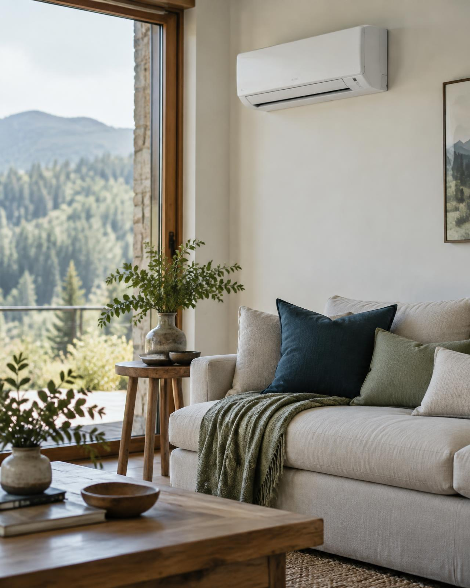

# Vento & Serra — site demonstrativo de climatização

> **Projeto de portfólio • empresa fictícia • sem atendimento comercial real.**

Site responsivo desenvolvido para demonstrar como um prestador de serviços locais pode apresentar seus serviços e facilitar a preparação de pedidos de orçamento pelo celular.

**[Abrir o projeto no Lovable](https://lovable.dev/projects/302151d7-7213-4309-8851-26e852288691)** · **[Tentar acessar a prévia de desenvolvimento](https://id-preview--302151d7-7213-4309-8851-26e852288691.lovable.app)**

## Visão geral



[Ver uma captura da interface gerada pelo Lovable](https://screenshot2.lovable.dev/lovp_52dyn22p128pptmzfjge9ytny1/f298668d6601e8f56f1592c3f38287f8_1794958071576.png)

*A imagem acima é o recurso visual utilizado no site, não uma fotografia de uma empresa real. A captura e o link da prévia dependem da disponibilidade do Lovable; não correspondem a um site comercial publicado.*

## Funcionalidades

- Layout adaptável para celular e desktop, com navegação por seções e menu móvel.
- Serviços de limpeza, instalação e manutenção de ar-condicionado.
- Fluxo **simulado** de solicitação de orçamento, com validação de campos obrigatórios.
- Geração local de um resumo do pedido, com botão para copiar a mensagem.
- Seção de perguntas frequentes e apresentação da área de atendimento fictícia.
- Estados de foco, textos alternativos e controles semânticos para acessibilidade básica.

**Privacidade da demonstração:** nenhum pedido é enviado a um servidor ou armazenado em banco de dados. Não existe WhatsApp real configurado no protótipo.

## Tecnologias utilizadas

| Camada | Tecnologias |
| --- | --- |
| Interface | React 19, TypeScript |
| Aplicação / rotas | TanStack Start e TanStack Router |
| Estilo | Tailwind CSS 4, shadcn/ui, Lucide |
| Validação | Zod |
| Testes | Vitest, Testing Library |
| Desenvolvimento | Lovable, GitHub, ChatGPT |

## Executar localmente

**Pré-requisitos:** [Bun](https://bun.sh/) instalado e versão compatível de Node.js.

```bash
git clone https://github.com/VitxrMDias/vento-serra-climatiza-o.git
cd vento-serra-climatiza-o
bun install
bun run dev
```

Abra o endereço local informado no terminal. Para verificar o projeto:

```bash
bun run test
bun run build
```

*Os comandos seguem os scripts presentes em `package.json`. A execução em ambientes externos ao Lovable ainda depende de verificação; não é uma promessa de implantação imediata.*

## Estrutura para personalização

- `src/config/site.ts`: nome, cidade, serviços, opções de formulário, textos, perguntas frequentes e `IS_DEMO`.
- `src/lib/quote.ts`: validação, montagem do resumo e eventual link de WhatsApp.
- `src/components/site/`: seções e componentes de apresentação.
- `src/styles.css`: variáveis de cores e estilos globais.
- `src/lib/quote.test.ts`: testes da lógica de orçamento.

Para uso por um cliente real, será necessário criar uma versão autorizada com dados e imagens reais, canal de atendimento confirmado, revisão de conteúdo, privacidade, testes e hospedagem apropriada. **Não basta remover o aviso de demonstração.**

## Objetivo e processo de desenvolvimento

O projeto integra um laboratório de serviços digitais para pequenos negócios. Usei ferramentas de IA (ChatGPT e Lovable) como apoio na concepção e implementação, com análise de requisitos, leitura de código, testes e revisão contínua. O objetivo é documentar decisões, estudar a base técnica e melhorar o projeto com feedback real.

**Etapa atual:** protótipo demonstrativo; não é uma empresa real nem um site comercial em produção.

## Próximos passos

- [ ] Conferência visual e de acessibilidade em diferentes navegadores e tamanhos de tela.
- [ ] Revisão de metadados de SEO e URL canônica para uma futura implantação real.
- [ ] Testes independentes de instalação e compilação local.
- [ ] Estratégia de hospedagem apropriada e aprovada para eventual uso comercial.
- [ ] Personalização para cliente real somente com autorização e contrato.

## Licença e uso de terceiros

Este repositório foi publicado para **apresentação de portfólio**. Na ausência de um arquivo `LICENSE`, a publicação no GitHub não concede automaticamente permissão ampla para copiar, revender ou redistribuir o código. O uso de marcas, fotos, bibliotecas e outros materiais de terceiros deve respeitar suas licenças e condições.

---

*Vento & Serra é uma marca fictícia criada exclusivamente para demonstração.*
